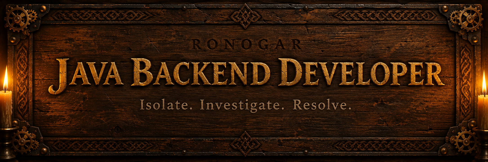

  

# Hey, I'm Ronogar 👋

Backend developer in training, based in Argentina. Learning Java and Spring Boot,
building real projects instead of just following tutorials, and getting ready
for my first job as a backend dev.

## 🔭 What I'm working on

**[appointment-system](https://github.com/Rong-ARG/appointment-system)** — a REST API for scheduling
appointments between clients and professionals. Built with Java 21, Spring Boot,
Spring Data JPA, MySQL, and Spring Security + JWT, with 155 unit and controller
tests (JUnit 5 + Mockito). I use it as my main practice project: adding features,
then going back and hunting for bugs (found and fixed a few real authorization
issues in there — check the README for details).

## 🧰 Tech I use

**Learning next:**

## 🌱 How I work

- I like understanding the "why" behind a fix
- I review my own code for bugs and security issues before calling something done
- When something breaks, I isolate it, dig into the cause, and only then fix it

## 📫 Find me

- GitHub: [@Rong-ARG](https://github.com/Rong-ARG)
- LinkedIn: [Pablo Abucewicz](https://www.linkedin.com/in/pablo-abucewicz-223169334/)
- Email: [abucewiczpablo@gmail.com](mailto:abucewiczpablo@gmail.com)

---
*Currently open to backend / junior developer opportunities.*